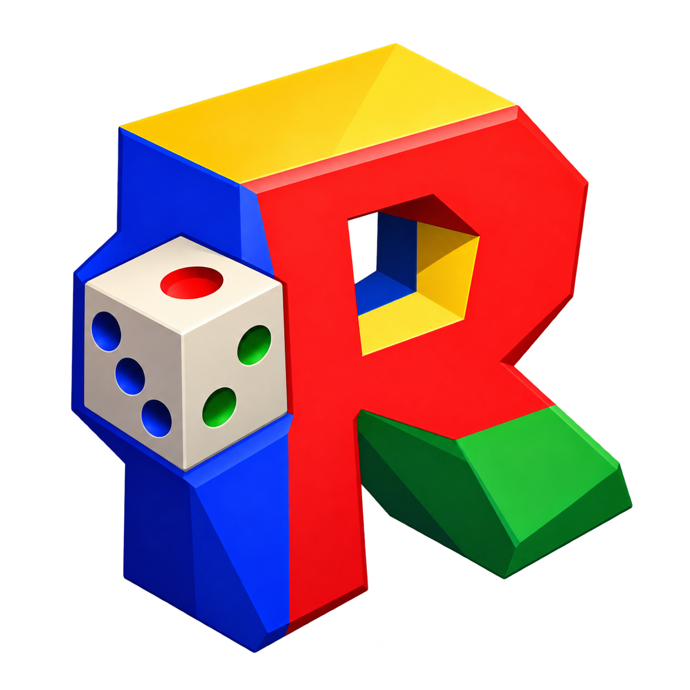
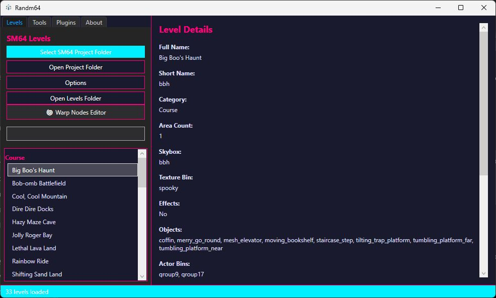
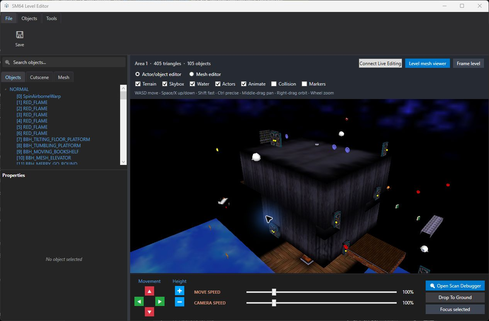
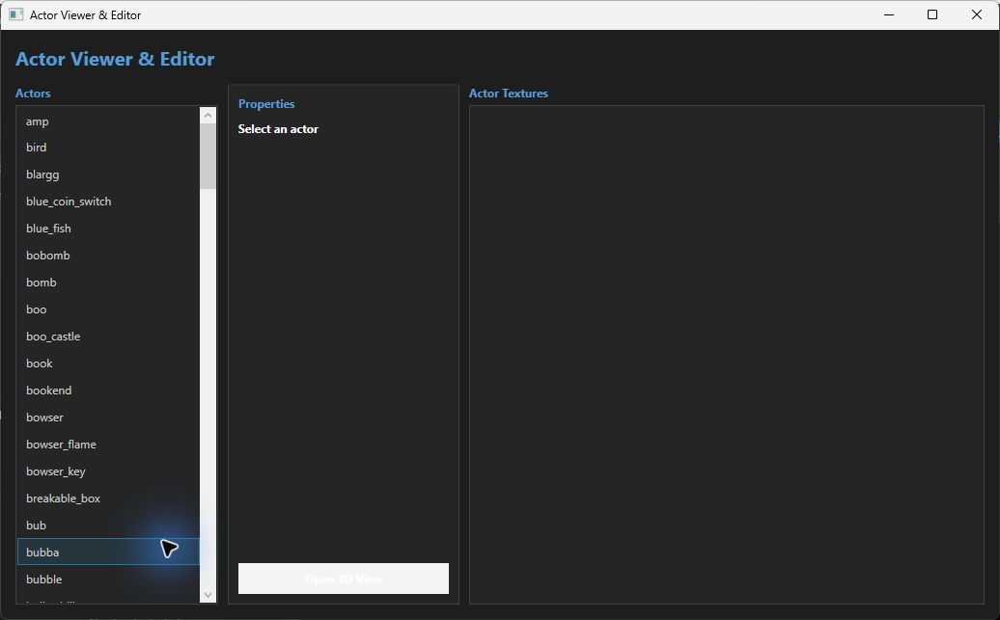
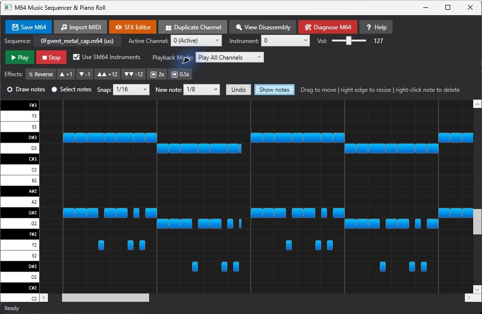
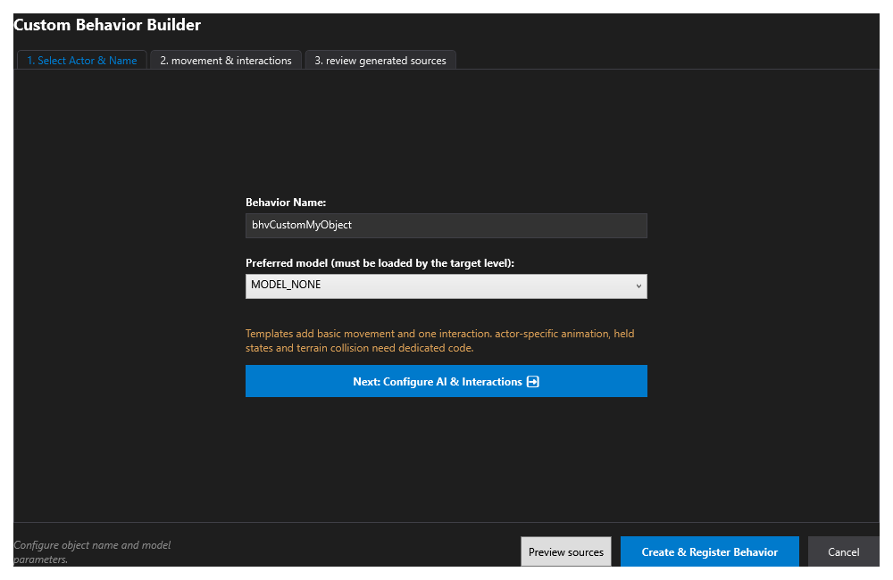
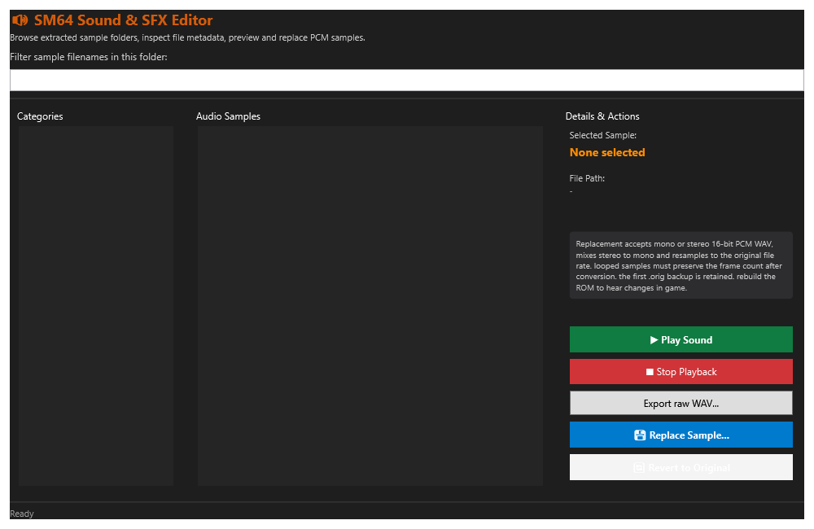
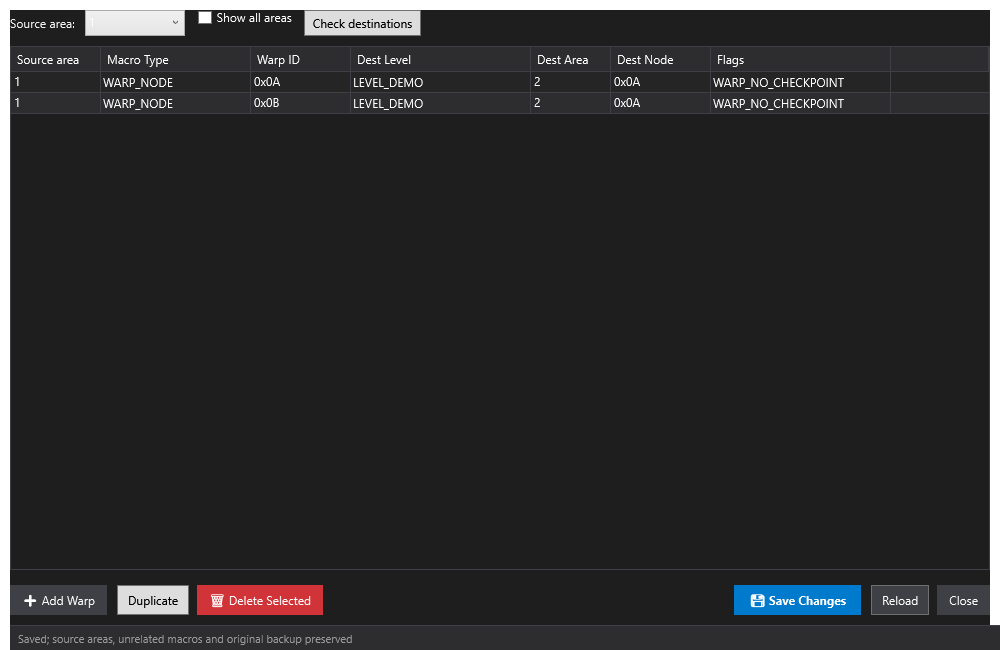

# Randm64



A Windows editor for Super Mario 64 decompilation projects. Explore levels in 3D, edit objects and collision, work with music and sound, create behaviors, and build your project from one application.

Randm64 edits source projects. It does not import compiled ROM hacks as editable projects. Available tools depend on the files and build layout of the selected repository.

## Application Overview



## Editors and Tools

| Tool | What You Can Do |
| --- | --- |
| Level Editor | Explore visual geometry and collision, select actors, edit positions and rotations, and drop objects onto the ground. |
| Mesh Editor | Edit collision vertices, triangles, surface types, and water boxes alongside the level viewport. |
| Actor Editor | Inspect actor models, textures, and animation previews. |
| Music Editor | Edit M64 notes, instruments, and channels. Preview with SM64 samples or the explicit MIDI option. |
| Sound Editor | Browse extracted samples, preview audio, export WAV files, and replace samples. |
| Text Editor | Edit individual dialogs and preview pages while preserving source macros. |
| Warp and Painting Editors | Edit warp connections and supported painting settings. |
| Behavior Builder | Configure a custom object and review generated source before creating it. |
| Chaos Engine | Apply configurable effects to supported game assets and source code, with presets and run reports. |
| Build and Patch Tools | Configure repository builds, inspect build output, manage source patches, and translate supported ROM addresses. |

### Editor Gallery

The main window, Level Editor, Actor Editor, and Music Editor below are desktop captures of Randm64. The Actor Editor is shown before selecting an actor so its directory field stays empty. Directory paths are not included in these screenshots. The remaining images are earlier UI renders with demonstration data.

<details open>
<summary><strong>Level Editor</strong></summary>



</details>

<details open>
<summary><strong>Actor Editor</strong></summary>



</details>

<details open>
<summary><strong>Music Editor</strong></summary>



</details>

<details open>
<summary><strong>Behavior Builder</strong></summary>



</details>

<details>
<summary><strong>Sound Editor</strong></summary>



</details>

<details>
<summary><strong>Warp Editor</strong></summary>



</details>

## System Requirements

These hardware tiers are estimates, not tested minimums or performance guarantees. Larger projects, high-resolution assets, Chaos operations, and game builds can require more memory and storage. Performance also depends on the selected decomp repository and build settings.

| Component | Minimum | Recommended | High End |
| --- | --- | --- | --- |
| Operating system | Windows 10 or 11, 64-bit | Windows 10 or 11, 64-bit | Windows 10 or 11, 64-bit |
| Processor | 2-core CPU, e.g. [Intel Core i3-6100](https://www.intel.com/content/www/us/en/products/sku/90729/intel-core-i36100-processor-3m-cache-3-70-ghz/specifications.html) | 4-core or faster CPU, e.g. [Intel Core i5-8400](https://www.intel.com/content/www/us/en/products/sku/126687/intel-core-i58400-processor-9m-cache-up-to-4-00-ghz/specifications.html) | 8-core or faster CPU, e.g. [AMD Ryzen 7 5700X](https://www.amd.com/en/support/downloads/drivers.html/processors/ryzen/ryzen-5000-series/amd-ryzen-7-5700x.html) |
| Memory | 4 GB RAM | 8 GB RAM | 16 GB RAM or more |
| Graphics | OpenGL 3.3 core-capable GPU, e.g. Intel HD Graphics 530 | OpenGL 3.3-capable GPU, e.g. Intel UHD Graphics 630 | OpenGL 3.3-capable dedicated GPU, e.g. [NVIDIA GeForce RTX 3060](https://www.nvidia.com/en-us/geforce/graphics-cards/30-series/rtx-3060-3060ti/) |
| Storage | 10 GB free | 20 GB free on an SSD | 40 GB or more free on an SSD |

The storage estimates include room for a decomp project, extracted assets, build output, and backups; actual needs vary by project. A working graphics driver is required for the 3D editors. Game builds need the toolchain required by the selected repository, generally through WSL or a supported MSYS2 setup. Framework-dependent releases also need the .NET 8 Desktop Runtime; building Randm64 from source needs the .NET 8 SDK or a compatible newer SDK.

## Getting Started

1. Install the .NET 8 Desktop Runtime to run Randm64, or the .NET 8 SDK to build it.
2. Prepare a compatible SM64 decompilation source project and its required assets. Follow that repository for extraction and build dependencies.
3. Build the SM64 project at least once so compiled assets are available to the level viewer.
4. Open Randm64 and select the project folder.
5. Choose a level and area, open an editor, and save your changes.
6. Rebuild the game to test source edits in your emulator or supported game target.

The 3D viewer requires working OpenGL support. Game compilation requires the toolchain expected by the selected repository, using WSL or a supported MSYS2 setup. Compatibility with modified repositories depends on their structure and features.

### Build Randm64 From Source

Run from the checkout root with the .NET 8 SDK or a compatible newer SDK:

```powershell
dotnet restore .\Randm64.csproj
dotnet build .\Randm64.csproj -c Release
.\bin\Release\net8.0-windows\Randm64.exe
```

You can also open `Randm64.csproj` in Visual Studio with the .NET desktop development workload.

## Live Editing With KernelN64

The initial bridge supports position, pitch, yaw, and roll edits for existing normal spawned objects and position/yaw edits for existing macro objects, including wooden signposts, in the active SM64 decomp build. Existing special objects, including castle grounds trees, support position edits; presets with a yaw field also support yaw. It requires a KernelN64 build that includes live editing protocol version 3. Update both applications together and restart KernelN64 after installing the new build.

1. Build the SM64 project and load that exact `.z64` ROM in KernelN64.
2. Enter the same level and area that you opened in Randm64.
3. Select an existing normal, macro, or supported special object in the Level Editor.
4. Click **Connect Live Editing** and choose the corresponding build ROM. Its `.map` file must be beside it.
5. Edit the transform. Click **Disconnect Live Editing** to end the session.

If KernelN64 is not running, live editing shows a waiting status and retries automatically. Open the updated KernelN64 build, load the selected ROM, and enter the selected level and area. Use **Stop Live Editing** to cancel waiting.

The bridge checks the running ROM hash, level, area, and original spawn record. Missing or ambiguous objects stop the session. Communication stays on the local machine through port `64640`, and memory writes run on the emulated CPU thread.

Macro objects use their original packed spawn record, preset, behavior, and parameters for matching. Dialog IDs remain unchanged. Pitch and roll for macro and special objects, custom special layouts with unknown extra fields, Mario, new objects, and live geometry or collision editing are not supported. Unresolved macro parameter expressions are shown as unavailable instead of guessed. Special objects are matched by preset behavior, model, area, parent, parameters, and expected transform. Each successful update advances the expected transform only after acknowledgment. Ambiguous or externally moved objects are rejected; reload the area and reconnect to restore a source-based match. Behaviors can overwrite transforms during gameplay. Save source edits and rebuild for persistent changes. Offline bridge checks pass; gameplay validation is still outstanding.

## Project Builds and Recovery

The build dialog detects supported targets and options from the selected repository. Compatible incremental builds retain existing output; configuration changes may require rebuilding. Build output includes command results and timing information.

For Windows-hosted projects, Randm64 can offer to import a copy into WSL for faster builds. The original folder remains available, and the two copies do not synchronize automatically.

Keep your decomp project under version control. Editors retain backups where supported, and Chaos runs record recovery information. Review failures before retrying or restoring files so later changes are preserved.

## Settings and Local Files

User configuration is stored under `Documents/Randm64/`:

- `Settings`: Application settings and Chaos presets.
- `Data/Plugins`: Local plugin assemblies.
- `Data/Patchs`: Source patch files.
- `Data/Custom Objects`: Behavior templates.

## Troubleshooting

- **Missing level textures:** Build the selected decomp project first and verify its extracted assets are available.
- **A tool is unavailable:** Check that the selected level or repository contains the source files that tool requires.
- **Live editing rejects the build:** Select the exact ROM loaded in KernelN64 and its matching map, then reconnect after rebuilding.
- **A source edit does not appear in game:** Save the edit, rebuild, and load the new game output.

Report reproducible problems through [GitHub Issues](https://github.com/denukernel/Randm64/issues). Include the tool, steps, repository variant, and relevant error text. Remove personal paths or other private data from logs before sharing them.

## License

See [LICENSE](LICENSE) for the MIT license and copyright notice. Third-party notices are retained under `ThirdParty/`.
